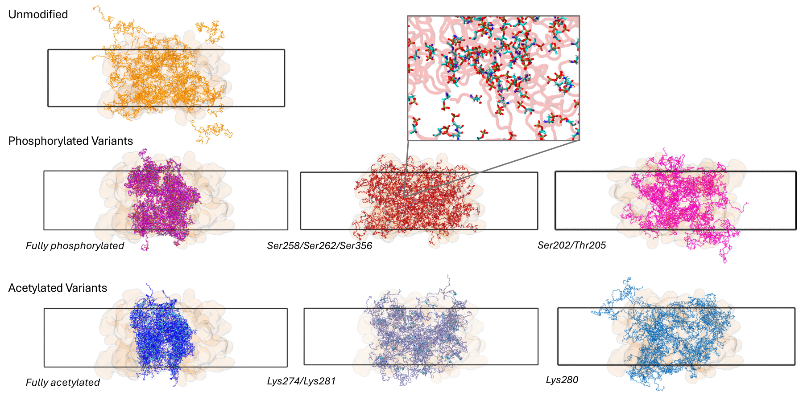

# Tau PTM simulations: analysis notebooks

Analysis code for the manuscript:

> **Tau phosphorylation and acetylation shift the balance between intramolecular and intermolecular interactions in condensates**
> Adelie Louet, Jan F. M. Stuke, Lisa M. Pietrek, Michele Vendruscolo, Gerhard Hummer

The notebooks analyse all-atom molecular dynamics simulations of the tau-K32 fragment in seven
post-translational modification (PTM) states, as isolated chains and in 60-chain condensates,
and the tau-K18 force-field benchmark.

*Representative snapshots of 60-chain tau-K32 condensates for the seven modification states. Rectangles
mark the initial slab boundary. The fully phosphorylated and fully acetylated condensates contract into
denser, narrower slabs, whereas the unmodified and sparsely modified condensates extend beyond it.*

## Notebooks

| Notebook | What it analyses |
|---|---|
| `analysis_files/single_chain_analysis_all_reps.ipynb` | Single-chain tau-K32: charge, radius of gyration, salt bridges, contacts, secondary structure, convergence |
| `analysis_files/condensate_analysis_all_reps.ipynb` | 60-chain condensates: density profiles, interchain and intrachain contacts, contact coupling, secondary structure, slab radius of gyration |
| `analysis_files/ff_comaparison.ipynb` | Force-field benchmark on tau-K18: radius of gyration, SAXS, residual dipolar couplings (RDCs) |
| `analysis_files/HCG_v_MD.ipynb` | Hierarchical chain growth (HCG) structures compared with MD |

## Requirements

Python 3 with:

- `numpy`, `scipy`, `pandas`
- `matplotlib`, `seaborn`
- `mdtraj`
- `MDAnalysis`
